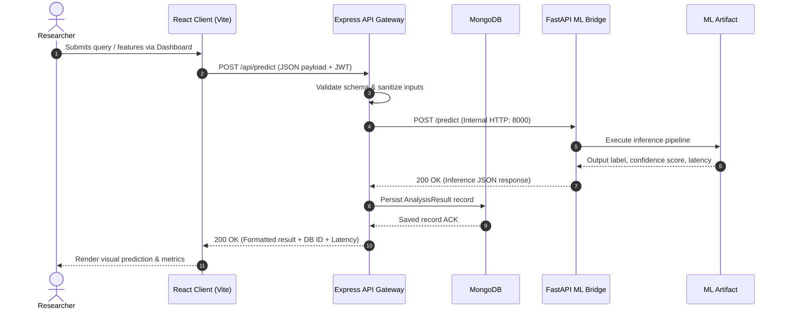

# SafeMaga Data Flow & Request Lifecycle

## 1. Inference Request Sequence Diagram

## 2. Research Data Ingestion & Model Lifecycle
1. **Raw Collection**: Datasets collected into `ai-ml/data/raw/`.
2. **Preprocessing Pipeline**: `src/preprocessing/clean_data.py` executes:
   - Null handling, duplicate removal.
   - Normalization / standardization.
   - Output emitted to `ai-ml/data/processed/cleaned_dataset.csv`.
3. **Training & Validation**: `src/training/train.py` executes:
   - Stratified train-test split.
   - Model parameter optimization.
   - Metric evaluation (Accuracy, F1-score, Precision/Recall).
   - Artifact export to `ai-ml/saved_models/baseline_model.joblib`.
4. **Bridge Serving**: FastAPI hot-loads the new artifact upon service initialization.
