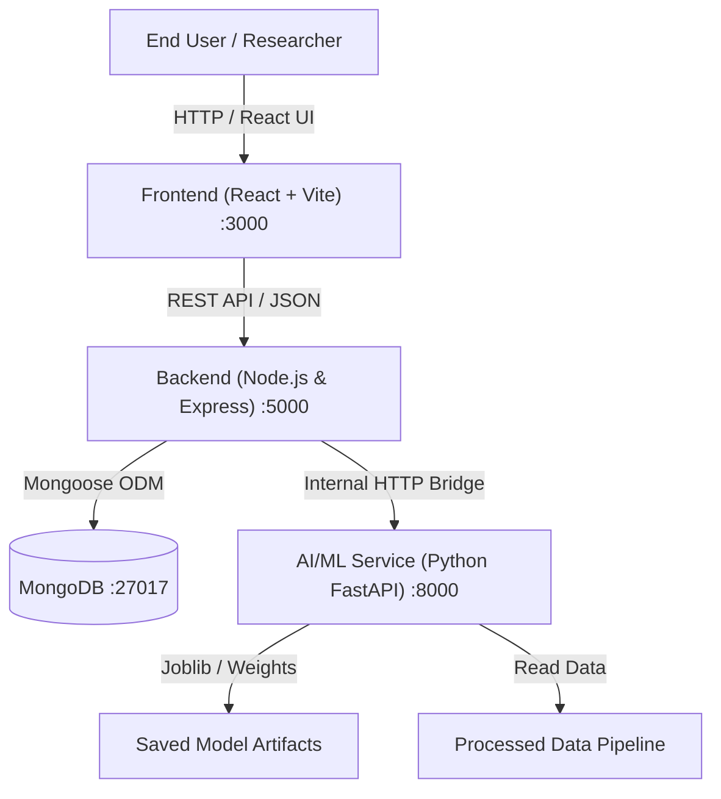

# SafeMaga System Architecture

## 1. Architectural Overview
SafeMaga is structured as a decoupled multi-tier research platform designed to combine modern web interactivity with intensive machine learning computational workflows.

## 2. Core Subsystems

### 2.1 Presentation Tier (`/frontend`)
- **Technology**: React 18, Vite, React Router 6, Axios.
- **Port**: `http://localhost:3000`
- **Responsibilities**:
  - Interactive research dashboard and exploratory controls.
  - Asynchronous dispatch of analytical queries and prediction payloads.
  - Real-time visualization of model confidence and inference metrics.

### 2.2 Application & Orchestration Tier (`/backend`)
- **Technology**: Node.js, Express, JWT, Mongoose.
- **Port**: `http://localhost:5000`
- **Responsibilities**:
  - Team authentication and role-based access control.
  - Gateway routing, payload sanitization, and request rate limiting.
  - Microservice bridging: Dispatches inference tasks to Python FastAPI.
  - Audit logging and historical result persistence in MongoDB.

### 2.3 Research & AI/ML Engine (`/ai-ml`)
- **Technology**: Python 3.10+, FastAPI, Scikit-learn, Pandas, NumPy, Uvicorn.
- **Port**: `http://localhost:8000`
- **Responsibilities**:
  - Deterministic data preprocessing pipelines (`src/preprocessing/`).
  - Model training, cross-validation, and metric logging (`src/training/`).
  - High-throughput asynchronous REST inference bridge (`api/main.py`).

### 2.4 Persistence Tier (`/database`)
- **Technology**: MongoDB 6.0+, Mongoose.
- **Port**: `mongodb://localhost:27017`
- **Responsibilities**:
  - User identity and research team credentials.
  - Longitudinal experiment tracking, inference telemetry, and historical results.
